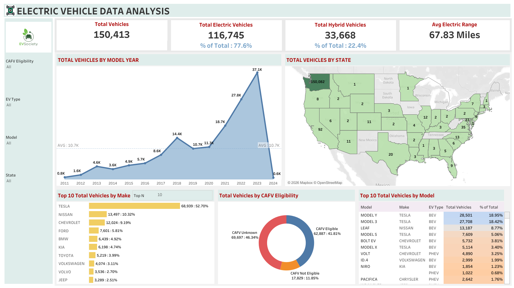

# Electric Vehicle Market Analysis

An interactive Tableau dashboard that turns 150,000+ electric vehicle (EV) registration records into a one-page view of the market: how fast adoption is growing, where vehicles are registered, which makers and models lead, and how battery electric (BEV) and plug-in hybrid (PHEV) vehicles compare.

**▶ [Open the live dashboard on Tableau Public](https://public.tableau.com/app/profile/harshil.patel1403/viz/ElectricVehicleDataAnalysis_17743671212720/Dashboard1)**

## At a glance
| KPI | Value |
|---|---|
| Total vehicles | **150,413** |
| Battery electric (BEV) | **116,745** (77.6%) |
| Plug-in hybrid (PHEV) | **33,668** (22.4%) |
| Average electric range | **67.8 miles** |

## Key insights
- **Adoption is accelerating.** Registrations climb from under 1,000 for model year 2011 to a peak of **37,100 for 2023**. The 2024 figure is low only because that model year was still incomplete in the data.
- **Fully electric leads.** BEVs make up more than three quarters of all EVs.
- **One maker dominates.** Tesla accounts for **52.7%** of vehicles, more than the next nine makers combined. The Model Y and Model 3 alone are over a third of the fleet.
- **Incentive eligibility is unclear for many vehicles.** 41.8% are eligible for Clean Alternative Fuel Vehicle (CAFV) incentives, 11.9% are not, and 46.3% are listed as unknown in the source data.
- **Registrations are concentrated in Washington State,** where the source data is collected. The map shows the small number registered elsewhere.

## Dashboard views
- KPI tiles: total vehicles, BEV and PHEV counts with share, and average electric range
- Total vehicles by model year (area chart with the average marked)
- Total vehicles by state (map)
- Top 10 makes, with an adjustable Top N
- Vehicles by CAFV eligibility (donut chart)
- Top 10 models with make, EV type and share
- Filters for CAFV eligibility, EV type, model and state

## How it was built
1. **Cleaned the data:** kept model years 2010 onward, removed missing or inconsistent electric range values, and standardized the BEV and PHEV labels.
2. **Defined the KPIs:** market size, BEV and PHEV share, and average range as a measure of battery progress.
3. **Built each view in Tableau** and combined them into one dashboard with shared filters.
4. **Published it on Tableau Public** and wrote up the findings in a report.

## Files
| File | What it is |
|---|---|
| `ElectricVehicleDataAnalysis.twbx` | Packaged Tableau workbook, data included. Opens in Tableau Desktop or Tableau Public. |
| `ELECTRICVEHICLEDATAANALYSISreport.docx` | Report: problem, dataset, KPIs, analysis and conclusions |
| `images/Dashboard_Preview.png` | Dashboard screenshot |

## Tools
Tableau Public · Microsoft Excel · data cleaning · KPI design · data storytelling

---
More of my work: **[harshilmayurpatel.github.io](https://harshilmayurpatel.github.io/)**
